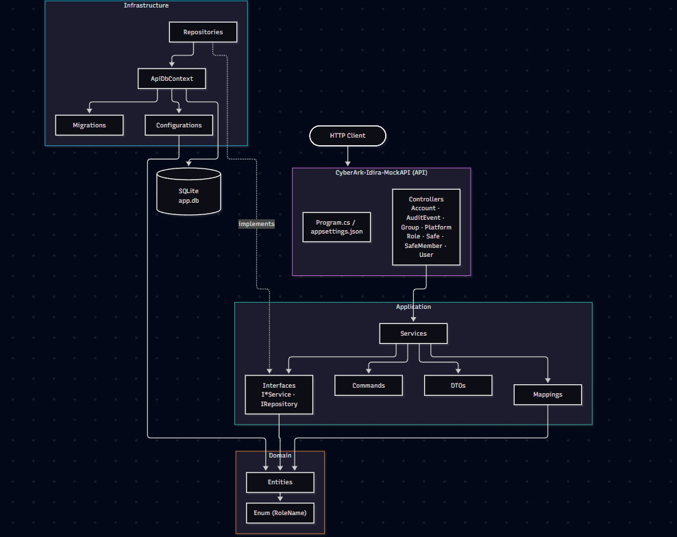

# CyberArk-Idira-MockAPI

CyberArk-Idira-MockAPI is a mock API for study purposes, inspired by publicly described CyberArk and shared-services concepts. It uses fictional users, resources, and data for local learning and experimentation.

> **Study use only.** This is an independent mock project. 
It is not an official CyberArk product, is not intended for production use, does not use any sensitive real data, and is not a production replacement. 

## Technical overview

- **Runtime and language:** .NET 10 and C#.
- **Web API:** ASP.NET Core Web API with REST-style controllers.
- **Persistence:** Entity Framework Core with SQLite for local mock data.
- **Architecture:** DDD-inspired layers separating domain concepts, application behavior, API contracts, and infrastructure.
- **Application patterns:** repositories, DTOs, commands, mappings, and application services.
- **Dependency management:** ASP.NET Core dependency injection.
- **API documentation:** Swagger/OpenAPI documentation for the mock API.
- **Data safety:** fictional seed data only; mock secrets must not be treated as real credentials or stored in logs.

    CyberArk-Idira-MockAPI/
    ├── CyberArk-Idira-MockAPI/                 # API (presentation layer)
    │   ├── Properties/
    │   │   └── launchSettings.json
    │   ├── Controllers/
    │   │   ├── AccountController.cs
    │   │   ├── AuditEventController.cs
    │   │   ├── GroupController.cs
    │   │   ├── PlatformController.cs
    │   │   ├── RoleController.cs
    │   │   ├── SafeController.cs
    │   │   ├── SafeMemberController.cs
    │   │   └── UserController.cs
    │   ├── app.db / app.db-shm / app.db-wal    # SQLite database
    │   ├── appsettings.json
    │   ├── Dockerfile
    │   ├── Program.cs
    │   └── README.md
    │
    ├── CyberArk-Idira-MockApi.Application/     # Use cases
    │   ├── Commands/        # Create/Update commands per entity + ChangeUserPasswordCommand
    │   ├── Dtos/            # Account, AuditEvent, Group, Platform, Role, Safe, SafeMember, User
    │   ├── Interfaces/      # I*Service contracts + IRepository
    │   ├── Mappings/        # Entity <-> DTO mappings
    │   └── Services/        # Account, AuditEvent, Group, Platform, Role, Safe, SafeMember, User
    │
    ├── CyberArk-Idira-MockApi.Domain/          # Core business model
    │   ├── Entities/
    │   │   ├── Account, AccountLink, AccountSecretVersion
    │   │   ├── ApiToken, AuditEvent, BulkUploadJob, DiscoveredAccount
    │   │   ├── Group, GroupMember, Platform
    │   │   ├── Role, Safe, SafeMember
    │   │   └── User, UserRole
    │   └── Enum/
    │       └── RoleName.cs
    │
    └── CyberArk-Idira-MockApi.Infrastructure/  # Data access
        ├── Configurations/                     # EF Core entity configurations (one per entity)
        ├── Data/
        │   └── ApiDbContext.cs
        ├── Migrations/
        │   ├── 20261028230630_InitialCreate.cs
        │   └── ApiDbContextModelSnapshot.cs
        └── Repositories/
            └── Repository.cs

## Domain concepts

The model may include users and roles, safes and members, accounts and secret versions, platforms, groups, discovered accounts, bulk upload jobs, and audit events. 
These are mock domain concepts; their presence does not imply that every corresponding CyberArk endpoint or workflow is implemented.

## Tests

Tests are planned for unit, integration, and contract coverage. Treat them as planned until corresponding test projects and test cases are present in the repository.

## Disclaimer

Use only with fabricated local data. Do not connect this mock to a real tenant, submit real credentials or exports, or rely on it for access control, secret management, auditing, or production operations. CyberArk is a trademark of its respective owner; this project is unaffiliated.
